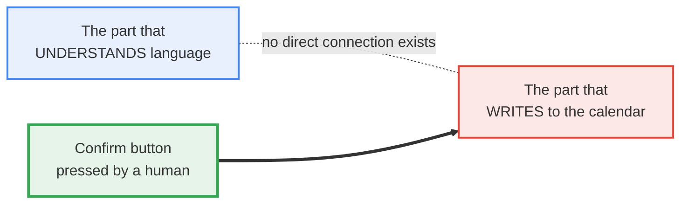
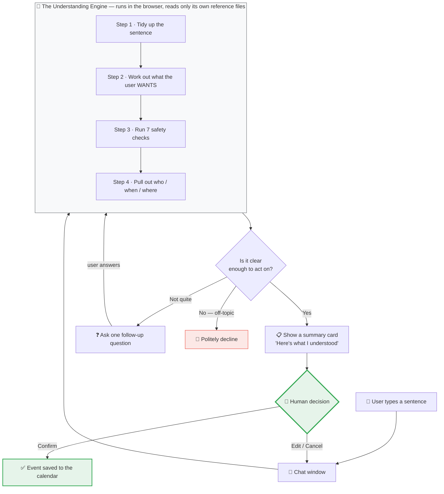
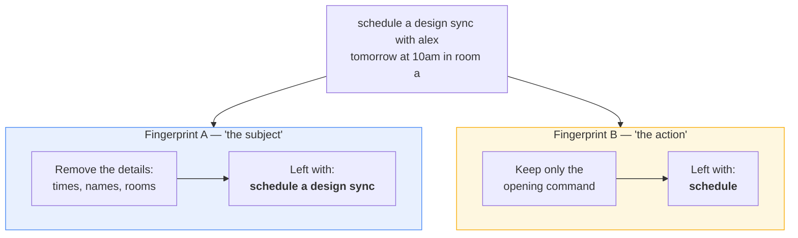
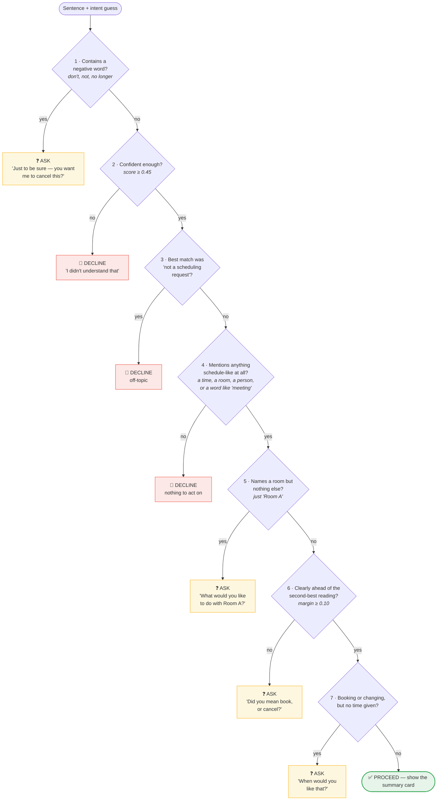
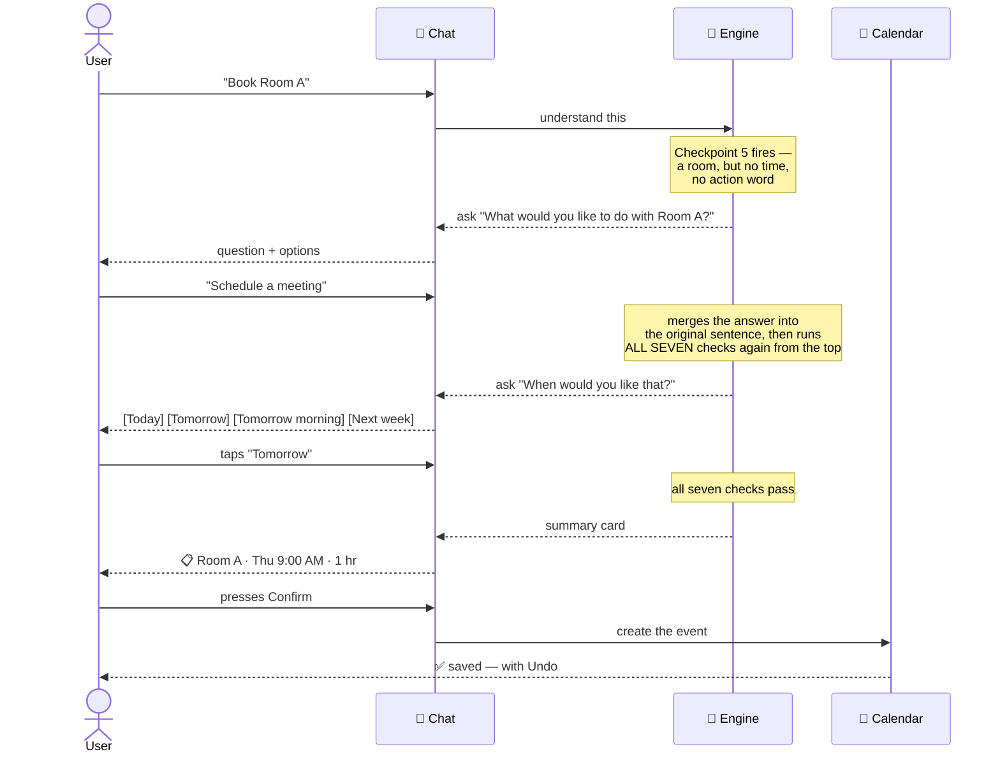
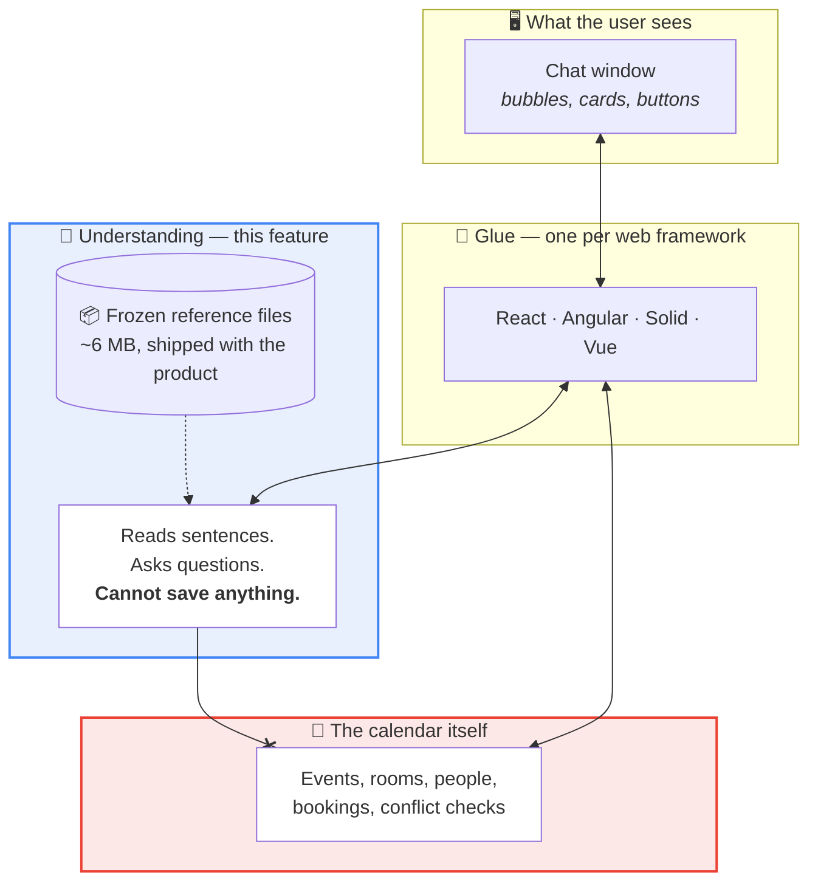

# How Janus Understands Plain English — A Non-Technical Walkthrough

**Audience:** anyone who needs to understand what this feature does, what it
promises, and what it cannot do. No programming knowledge assumed.

**Companion document:** [NLP_CODE_MAP.md](NLP_CODE_MAP.md) maps every stage
described here to the exact file that performs it.

---

## 1. In one paragraph

A user types an ordinary sentence — _"Schedule a design sync with Alex tomorrow
at 10am in Room A"_ — into a chat box. Janus works out **what they want done**,
**who** it involves, **when** it should happen and **where**. It then shows that
understanding back to the user as a small summary card and waits. Nothing is
added to the calendar until the user presses **Confirm**. If the sentence is
unclear, Janus asks a follow-up question instead of guessing.

---

## 2. The promise that shapes everything

> **Janus never writes to the calendar on its own. It understands, it shows
> what it understood, it asks — and only a human press of "Confirm" changes
> anything.**

This is not a policy someone remembers to follow. It is built into the
structure: the component that does the understanding has **no physical
connection** to the calendar. It cannot save an event even if it wanted to. The
only piece of code that can save anything sits behind the Confirm button.



---

## 3. Three things worth knowing up front

|                                                       | What it means for the business                                                                                                                           |
| ----------------------------------------------------- | -------------------------------------------------------------------------------------------------------------------------------------------------------- |
| **No AI service is called**                           | There is no ChatGPT, no cloud AI, no API bill. Understanding happens entirely inside the user's own browser.                                             |
| **Nothing the user types ever leaves their computer** | Sentences are never transmitted anywhere. This removes an entire category of privacy and compliance concern.                                             |
| **The result is identical every time**                | The same sentence always produces the same answer — today, next year, for every user. There is no randomness, so behaviour can be tested and guaranteed. |

**How is that possible without AI?** During development, the system was taught
using a language model _once_, offline. The result of that teaching was
"frozen" into three reference files that ship with the product — roughly 6 MB
in total. At runtime the system does not think; it **looks things up** in those
files. It is closer to a very fast, very literal clerk with a memorised
phrasebook than to a chatbot.

---

## 4. The big picture



---

## 5. Following one sentence all the way through

Our example: **"Schedule a design sync with Alex tomorow at 10am in Room A"**
— note the typo in _tomorow_, deliberately included.

### Stage 0 — Fix obvious typos _(optional, off by default)_

Janus keeps a short list of 14 time-related words it cares about — _tomorrow,
morning, Tuesday, afternoon_ and so on. If a typed word is one or two letters
away from one of those, it is corrected, and **the correction is shown to the
user** on the card ("read _tomorow_ as _tomorrow_"). It is never done silently.

Only time words are corrected. Names of people and rooms are left exactly as
typed, because "Room A" and "Room B" are one letter apart and a silent
correction there would book the wrong room.

> `tomorow` → `tomorrow`

### Stage 1 — Tidy up

The sentence is reduced to a plain, comparable form: lowercase, punctuation
removed, shorthand expanded (_w/_ becomes _with_, _don't_ becomes _do not_).

> `schedule a design sync with alex tomorrow at 10am in room a`

### Stage 2 — Chop into known pieces

The sentence is broken into fragments the system has seen before. Unfamiliar
words are broken into smaller familiar parts, and anything still unrecognisable
is marked "unknown" rather than being guessed at.

### Stage 3 — Turn the sentence into a "fingerprint"

Each recognised fragment has a fixed numeric fingerprint stored in the reference
files. These are combined into a single fingerprint for the whole sentence, with
common filler words ("a", "the", "with") counting for less than meaningful ones.

**Janus actually makes two fingerprints of every sentence, and this is the
clever part:**



**Why two?** Because the details are noise when you're trying to work out
someone's _intent_. "Book Room A at 3pm" and "Book the projector on Friday" are
the same request; the specifics only obscure that. Fingerprint A strips them
away. Fingerprint B isolates the verb — the single strongest clue to what
someone wants. Judging on both together is far more reliable than either alone.

### Stage 4 — Compare against known examples

The reference files hold a library of example sentences, each already labelled
with what it means. Janus compares the new sentence's two fingerprints against
every example and takes the **five closest matches**. Those five vote.

The winning label is the **intent**. There are exactly five possible outcomes:

| Intent                | Plain meaning                         | Example                         |
| --------------------- | ------------------------------------- | ------------------------------- |
| **Add event**         | Put something in the calendar         | "Book Room A tomorrow at 2pm"   |
| **Change event**      | Move or alter something already there | "Move the standup to Thursday"  |
| **Cancel event**      | Remove something                      | "Cancel the 3pm review"         |
| **Look up**           | Read-only question, changes nothing   | "What's on my calendar Friday?" |
| **None of the above** | Not a scheduling request at all       | "What's the weather?"           |

The vote also produces two numbers that matter a great deal:

- **Confidence** — how strongly the sentence resembles the winning category.
- **Margin** — how far ahead the winner is of the runner-up. A high confidence
  with a _low_ margin means "this looks like scheduling, but I can't tell
  whether you want to book or to cancel" — genuinely ambiguous, and treated
  very differently from simply being unsure.

### Stage 5 — The seven checkpoints

This is the heart of the safety design. Before Janus acts on its guess, the
sentence must pass **seven checks in a fixed order**. The first one that fails
decides the outcome — the rest are not run.



Three outcomes, and the difference between two of them is the whole point:

| Outcome        | Meaning                                     | What the user sees                                 |
| -------------- | ------------------------------------------- | -------------------------------------------------- |
| ✅ **Proceed** | Confident and unambiguous                   | The summary card                                   |
| ❓ **Ask**     | Understood the topic, missing one piece     | One specific question with tappable options        |
| 🚫 **Decline** | Not a scheduling request, or unintelligible | A polite refusal with an example of what does work |

**"Ask" is not a failure.** Roughly two out of five real scheduling sentences
land here — because people naturally say "book Room A" without a time. Before
the conversation layer existed, every one of those was a dead end. Now each is
a question.

**Why does the order of the checks matter?** Because it decides what the user is
_told_. A sentence that is both unclear _and_ off-topic should be reported as
"I didn't understand", not as "that's not about scheduling" — the first is
honest, the second is a guess about why. Reordering the checks would change the
explanation the user receives.

### Stage 6 — Pull out the details

Once the checks pass, a **separate** process re-reads the original sentence to
extract the specifics. This runs _after_ the decision, never during it — so no
detail can ever change what Janus decided the user wanted.

| Detail    | From our example   | How                                                                                                                                           |
| --------- | ------------------ | --------------------------------------------------------------------------------------------------------------------------------------------- |
| **Who**   | Alex Rivera        | Matched against _your organisation's actual people_, not a fixed list. "Alex" matching "Alex Rivera" is allowed for people only.              |
| **When**  | Tomorrow, 10:00 AM | Understands _tomorrow_, _next Tuesday_, _the 15th_, _3pm_, _half past two_, _morning_ — and handles time zones and daylight-saving correctly. |
| **Where** | Room A             | Matched against _your actual rooms and equipment_.                                                                                            |
| **What**  | "design sync"      | Whatever is left over once the command word and the details are removed.                                                                      |

**Sensible defaults, always disclosed.** If the user gives a day but no time,
Janus assumes 9:00 AM. If no duration, one hour. Every such assumption is
**shown on the card in a visibly different style** — a dashed outline plus a
plain-English note ("no time of day given — assumed 09:00"). The user can see at
a glance which parts they said and which parts Janus filled in.

### Stage 7 — The summary card

```
┌─────────────────────────────────────────────────┐
│  Here's what I understood —                     │
│                                                 │
│  design sync                                    │
│                                                 │
│  [ 👤 Alex Rivera ]  [ 🕐 Thu 10:00 AM ]        │
│  [ ⏱ 1 hr ]          [ 📍 Room A ]              │
│                                                 │
│  ℹ read "tomorow" as "tomorrow"                 │
│                                                 │
│  87% sure this is a booking                     │
│                                                 │
│         [ Edit ]     [ Confirm & schedule ]     │
└─────────────────────────────────────────────────┘
```

The card adapts to the request. A cancellation is styled as a warning, and its
button reads **"Cancel event"** with the alternative labelled **"Keep it"** — so
a mis-tap on a destructive action is much harder.

### Stage 8 — Confirm, and only then, save

Pressing Confirm hands the finished details to the calendar. This is the only
moment anything is written. Every save also produces an **Undo**.

---

## 6. When Janus asks instead of guessing



**The rule that makes this trustworthy:** answering one question never lets a
sentence skip the others. After every answer, the merged sentence is put through
**all seven checks again, from the beginning**. Confirming "yes, I do mean
cancel" does not grant a free pass on "but when?".

**It will not badger.** If the same question has been asked twice without
getting a usable answer, Janus stops and suggests starting over — which is
honest, where an endless loop is not.

**Users can skip.** Optional questions carry a _Skip_ option. Skipping is
recorded and disclosed on the card ("you skipped the room — it will go to
Room A"), never hidden.

---

## 7. How the pieces fit together



The crossed line is deliberate and enforced automatically: the understanding
layer is **forbidden** from referencing the calendar. Any attempt to connect
them fails the build. That is what turns "we always confirm before saving" from
a promise into a guarantee.

The understanding layer also has **zero external dependencies** — it borrows no
third-party code whatsoever. Nothing outside the team can change how it behaves,
break it with an update, or introduce a security issue into it.

---

## 8. What it can and cannot do

### ✅ Handles well

- All four calendar actions: add, change, cancel, look up
- Natural dates and times — _tomorrow, next Tuesday, the 15th, 3pm, half past
  two, in the morning_, and durations like _for 2 hours_
- Your organisation's real rooms, equipment and people, by full or partial name
- Time zones and daylight-saving transitions
- Polite phrasing — _"could you please book…"_, _"I'd like to schedule…"_
- Common typos in time words
- Multi-turn conversations, where the answer to one question is remembered

### ⚠️ Deliberately asks rather than guesses

- A room with no time or action — _"Room A"_
- Anything phrased negatively — _"don't book Room A"_ — always confirmed first
- Genuinely ambiguous phrasing where two readings score nearly equally

### 🚫 Cannot do

- **Multiple events in one sentence.** _"Book Monday and Tuesday"_ produces one
  event, not two.
- **Complex conditional logic.** _"Book it unless Sarah is busy"_ is not
  understood.
- **Recurring events by voice.** _"Every Tuesday"_ is not yet supported through
  chat — the calendar itself supports recurrence, but the chat cannot request it.
- **Languages other than English.**
- **Ambiguous references to existing events.** Cancelling requires enough detail
  to identify exactly one event. If two events match the description, Janus
  refuses rather than deleting the wrong one.

### 📌 A known and accepted limitation

Three specific unusual sentences are known to be classified incorrectly. These
were found during testing and **deliberately left as they are**, because the
system's behaviour is frozen and verified against a fixed reference. Changing a
setting to fix those three would silently alter thousands of other sentences and
invalidate the entire test record. The trade — three known, documented,
low-impact errors in exchange for behaviour that is completely predictable and
provable — was made consciously.

---

## 9. Quality and cost at a glance

|                             |                                                                                                                           |
| --------------------------- | ------------------------------------------------------------------------------------------------------------------------- |
| **Automated tests**         | 1,423 for the understanding layer alone; the safety-checkpoint code is at 100% coverage                                   |
| **Speed**                   | Understanding takes milliseconds. Loading the 6 MB reference files takes 1–3 seconds, once per session, in the background |
| **Running cost**            | Zero. No AI service, no per-message charge, no server work                                                                |
| **Data leaving the device** | None                                                                                                                      |
| **Offline**                 | Works fully once the page has loaded                                                                                      |
| **Behaviour over time**     | Fixed. It cannot drift, degrade, or change because a vendor updated a model                                               |

---

## 10. Current status

| Area                                          | State                                                |
| --------------------------------------------- | ---------------------------------------------------- |
| Understanding engine                          | ✅ Complete, frozen, fully tested                    |
| Detail extraction — who / when / where / what | ✅ Complete                                          |
| Question-and-answer conversation              | ✅ Complete                                          |
| Chat interface                                | ✅ Complete                                          |
| Live calendar connection                      | ✅ Working in the React demo, pending final sign-off |
| Rollout to Angular / Solid / Vue              | ⬜ Not started                                       |
| Visual polish, accessibility, mobile layout   | ⬜ Planned                                           |

---

_For the file-by-file technical mapping of everything described here, see
[NLP_CODE_MAP.md](NLP_CODE_MAP.md)._
