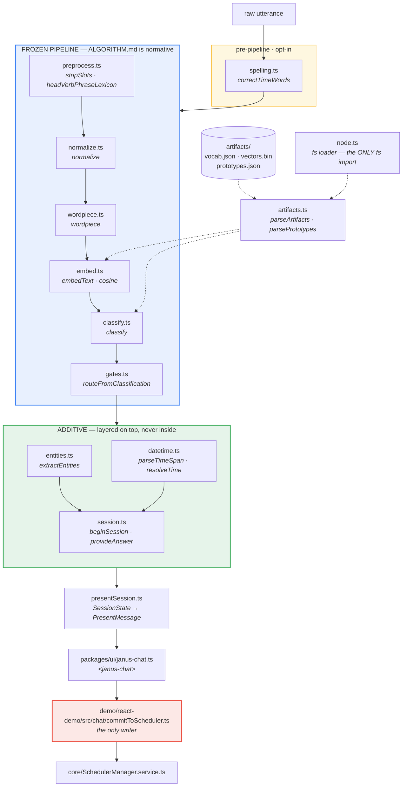
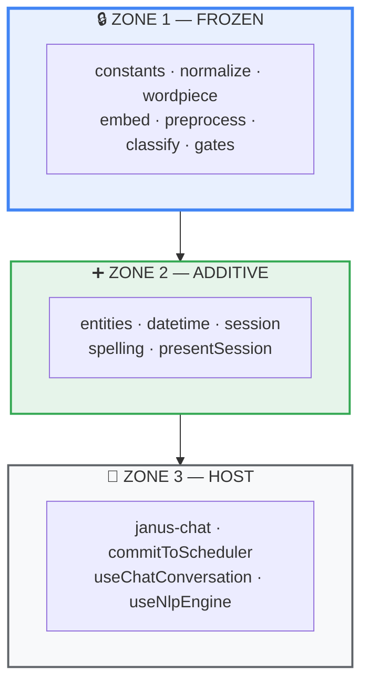
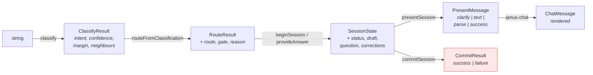

# NLP Code Map — Which File Does What

**Audience:** engineers working on or reviewing the natural-language feature.

**Companion document:** [NLP_ARCHITECTURE_OVERVIEW.md](NLP_ARCHITECTURE_OVERVIEW.md)
explains the same system in non-technical language. Every stage named there maps
to a row in this document.

---

## 1. The one-screen answer



---

## 2. Stage → file, in execution order

Every row maps a stage from the business overview to the code that performs it.

| #   | Stage (business doc §5)        | File                                                                                              | Key exports                                                                | LOC |
| --- | ------------------------------ | ------------------------------------------------------------------------------------------------- | -------------------------------------------------------------------------- | --- |
| 0   | Fix obvious typos              | [packages/nlp/src/spelling.ts](../packages/nlp/src/spelling.ts)                                   | `correctTimeWords`, `TIME_VOCABULARY`                                      | 240 |
| 1   | Tidy up the sentence           | [packages/nlp/src/normalize.ts](../packages/nlp/src/normalize.ts)                                 | `normalize`, `escapeRe`, `alternation`                                     | 74  |
| 2   | Build the two views            | [packages/nlp/src/preprocess.ts](../packages/nlp/src/preprocess.ts)                               | `stripSlots`, `headVerbPhraseLexicon`, `TIME_RE_SOURCE`                    | 119 |
| 3   | Chop into known pieces         | [packages/nlp/src/wordpiece.ts](../packages/nlp/src/wordpiece.ts)                                 | `wordpiece`                                                                | 67  |
| 4   | Turn into a fingerprint        | [packages/nlp/src/embed.ts](../packages/nlp/src/embed.ts)                                         | `embedText`, `cosine`                                                      | 71  |
| 5   | Compare against known examples | [packages/nlp/src/classify.ts](../packages/nlp/src/classify.ts)                                   | `classify`                                                                 | 109 |
| 6   | The seven checkpoints          | [packages/nlp/src/gates.ts](../packages/nlp/src/gates.ts)                                         | `routeQuery`, `routeFromClassification`, `hasNegation`, `hasTimeAnchor`, … | 193 |
| 7a  | Pull out who / where / what    | [packages/nlp/src/entities.ts](../packages/nlp/src/entities.ts)                                   | `extractEntities`, `leadingVerbPrefixLength`                               | 373 |
| 7b  | Pull out when                  | [packages/nlp/src/datetime.ts](../packages/nlp/src/datetime.ts)                                   | `parseTimeSpan`, `resolveTime`, `zonedToUtcMs`, `zonedPartsAt`             | 642 |
| 8   | Ask, merge, re-route           | [packages/nlp/src/session.ts](../packages/nlp/src/session.ts)                                     | `beginSession`, `provideAnswer`, `stripNegationCues`                       | 839 |
| 9   | Shape for the UI               | [packages/nlp/src/presentSession.ts](../packages/nlp/src/presentSession.ts)                       | `presentSession`, `draftChips`, `assumptionNotes`, `summarise`             | 291 |
| 10  | Render the chat                | [packages/ui/src/janus-chat.ts](../packages/ui/src/janus-chat.ts)                                 | `<janus-chat>`                                                             | 615 |
| 11  | **Write to the calendar**      | [demo/react-demo/src/chat/commitToScheduler.ts](../demo/react-demo/src/chat/commitToScheduler.ts) | `commitSession`, `catalogFromResources`                                    | 258 |

### Supporting files (not in the data path)

| File                                               | Role                                                      | LOC |
| -------------------------------------------------- | --------------------------------------------------------- | --- |
| [constants.ts](../packages/nlp/src/constants.ts)   | Every frozen number and word list, in one place           | 390 |
| [types.ts](../packages/nlp/src/types.ts)           | All public and internal types                             | 554 |
| [artifacts.ts](../packages/nlp/src/artifacts.ts)   | Pure buffer decoding — no I/O of any kind                 | 101 |
| [node.ts](../packages/nlp/src/node.ts)             | The **only** module permitted to import `node:fs`         | 60  |
| [index.ts](../packages/nlp/src/index.ts)           | The pure public entry point, `"."`                        | 203 |
| [controller.ts](../packages/nlp/src/controller.ts) | Framework-agnostic state machine — **incomplete, see §8** | 235 |

---

## 3. Three zones, and the rules that separate them

The single most important thing to understand before editing anything here.



### 🔒 Zone 1 — Frozen

`packages/nlp/docs/ALGORITHM.md` is **normative**. These files are a
parity-verified port of a research implementation, pinned by a 120-row parity
fixture and a 237-row routing fixture.

**Do not change a constant, a list ordering, or a step ordering.** There is no
Python implementation left to re-derive the fixtures from — the artifacts would
have to be rebuilt from scratch. Several things in here look like bugs and are
load-bearing; each is commented at its site with the ALGORITHM.md section that
justifies it:

- `none` is scored on a different α/β blend than the event intents
  (`classify.ts` L38-45)
- `margin` excludes `none` from the runner-up search **even when `none` wins**
  (`classify.ts` L60-77)
- `lunch` is left in `EVENT_NOUNS`
- Gates run on **pre-strip raw text**, never on `stripSlots(text)`
  (`gates.ts` header)
- Word-list ordering feeds _stable_ sorts, so re-alphabetising changes
  tokenization (`constants.ts` header)

The 3 known false accepts are reproduced deliberately.

### ➕ Zone 2 — Additive

Layered **on top of** Zone 1, never inside it. The invariant, stated in
`session.ts` L18-27:

> A satisfied gate is suppressed only through an input the frozen function
> already takes — the `marginFloor` parameter, or a negation-cue-blanked text —
> and then the whole gate ladder is re-run from the top. No gate is ever
> skipped by index.

Concretely, `evaluate()` in `session.ts` L476-616 does exactly two things to
suppress an answered question, and both are ordinary arguments:

```ts
const probe = satisfied.includes("negation") ? stripNegationCues(text) : text;
const marginFloor = satisfied.includes("gate4_margin")
  ? Number.NEGATIVE_INFINITY
  : MARGIN_FLOOR;
const route = routeFromClassification(result, probe, CONF_FLOOR, marginFloor);
```

Note that `classify()` above it always runs on the **original** text, cue
included. `"don't book Room A"` must classify as a cancellation so the
confirmation question matches the action — see the comment at `session.ts`
L488-499.

Zone 2 also owns the entity catalog decision: `extractEntities` takes the
catalog as a **parameter**, never an import. That is what keeps
`@janus-scheduler/nlp` free of any dependency on `@janus-scheduler/core`, and
it stops the frozen research corpus (`"sarah"`, `"parking"`, `"marketing"`)
from leaking real-looking names into a user's parse card.

### 🔌 Zone 3 — Host

Framework-specific. The only zone that may touch the scheduler.

---

## 4. The four hard constraints, and where each is enforced

| Constraint                                         | Enforced by                                                    | Breaking it shows up as                  |
| -------------------------------------------------- | -------------------------------------------------------------- | ---------------------------------------- |
| **Zero runtime dependencies**                      | `packages/nlp/package.json` has no `dependencies` block at all | A `dependencies` key appearing           |
| **Nothing imports `@janus-scheduler/core`**        | Not in `package.json`; catalog passed as a parameter           | Build failure in `packages/nlp`          |
| **Root entry `"."` is pure — no `fs`, no `fetch`** | `node.ts` is a separate export at `"./node"`                   | The browser demo fails to build          |
| **Artifacts are never statically imported**        | `useNlpEngine.ts` uses `?url` + `fetch`                        | App bundle jumps from ~590 kB to ~6.6 MB |

The third and fourth are checked in practice by
[demo/react-demo/src/chat/useNlpEngine.ts](../demo/react-demo/src/chat/useNlpEngine.ts):
if the pure entry ever picked up a Node import, that module would not build.

---

## 5. Data contracts between the layers



All of these live in [packages/nlp/src/types.ts](../packages/nlp/src/types.ts)
except `PresentMessage` (colocated in `presentSession.ts`) and `CommitResult`
(colocated in `commitToScheduler.ts`).

Key discriminants:

| Type              | Field    | Values                                                                                                                                               |
| ----------------- | -------- | ---------------------------------------------------------------------------------------------------------------------------------------------------- |
| `RouteResult`     | `route`  | `PROCEED` · `CLARIFY` · `REJECT`                                                                                                                     |
| `RouteResult`     | `gate`   | `null` · `negation` · `gate1_confidence` · `gate2_nearest_none` · `gate3_no_anchor` · `gate3b_resource_only` · `gate4_margin` · `gate5_missing_slot` |
| `SessionState`    | `status` | `ready` · `awaiting` · `declined`                                                                                                                    |
| `SessionQuestion` | `slot`   | `when` · `resource` · `title` · `intent` · `confirm`                                                                                                 |
| `ClassifyResult`  | `intent` | `add_event` · `modify_event` · `delete_event` · `get_details` · `none`                                                                               |

---

## 6. The commit boundary

`commitToScheduler.ts` is the **only** file in the entire feature that writes
anything. It is reachable from exactly one place: the Confirm handler in
`useChatConversation.ts`.

| Intent         | What `commitSession` does                                           |
| -------------- | ------------------------------------------------------------------- |
| `add_event`    | `SchedulerManager.addEvent` — merges resources **and** participants |
| `modify_event` | `resolveTarget` → `SchedulerManager.updateEvent`                    |
| `delete_event` | Snapshots the event first (for accurate Undo) → `deleteEvent`       |
| `get_details`  | Read-only. Navigates the view; writes nothing                       |

`resolveTarget()` (L87) **refuses on 0 matches and on more than 1 match**. It
never picks the first of several candidates — deleting the wrong event is worse
than declining.

Per `CLAUDE.md`, all writes go through `SchedulerManager` — never
`schedulerStore` directly — so optimistic-update-plus-rollback and the lifecycle
hooks stay intact.

---

## 7. Artifacts and how they are loaded

| File                        | Size    | Contents                                                                                 |
| --------------------------- | ------- | ---------------------------------------------------------------------------------------- |
| `artifacts/vocab.json`      | 487 kB  | Token strings, per-token quantization scales, Zipf weights, `dim`, `unkId`, pooling mode |
| `artifacts/vectors.bin`     | 3.06 MB | The int8 embedding table, raw                                                            |
| `artifacts/prototypes.json` | 2.49 MB | Labelled example sentences with their two float vectors each                             |

Two loaders, one decoder:

| Environment | Loader                                                          | Path                         |
| ----------- | --------------------------------------------------------------- | ---------------------------- |
| Node / Jest | `@janus-scheduler/nlp/node` → `loadArtifacts`, `loadPrototypes` | `node:fs` → `parseArtifacts` |
| Browser     | `useNlpEngine.ts` → `fetch` on `?url` assets                    | `fetch` → `parseArtifacts`   |

Both funnel into `artifacts.ts`, so there is exactly one implementation of the
decode path. Two details there are not cosmetic:

- `toInt8Table` passes `byteOffset`/`byteLength` explicitly, because Node's
  `Buffer` is a view into a **shared pooled** `ArrayBuffer` — `new
Int8Array(buf.buffer)` alone would expose the whole pool and misalign every
  row.
- `parsePrototypes` uses `Float32Array.from`, because `cosine()` requires both
  operands at float32; a plain `number[]` from JSON carries float64 precision
  and drifts from the Python reference.

`prototypes.json` is 2.49 MB purely because it stores float vectors as JSON
text. Packing it binary, as `vectors.bin` already is, is an open optimisation.

---

## 8. Tests

```bash
npm test -w @janus-scheduler/nlp     # 1423 tests
```

| Suite                    | LOC | Covers                                                                               |
| ------------------------ | --- | ------------------------------------------------------------------------------------ |
| `parity.test.ts`         | 284 | 120-row fixture — `normalized`, `ids`, and both vectors against the Python reference |
| `routing.test.ts`        | 240 | 237-row fixture — every gate decision                                                |
| `pipeline.test.ts`       | 229 | End-to-end `routeQuery`                                                              |
| `session.test.ts`        | 921 | The dialogue manager, including the "answering never lowers the bar" invariant       |
| `datetime.test.ts`       | 496 | Date/time parsing, timezones, DST                                                    |
| `entities.test.ts`       | 310 | Catalog matching, partial-name rules                                                 |
| `spelling.test.ts`       | 246 | Typo correction, and that every corrected word is one `hasTimeAnchor` accepts        |
| `presentSession.test.ts` | 163 | Chip and note generation                                                             |
| `node-loader.test.ts`    | 99  | The `fs` loader                                                                      |

`gates.ts` is at 100% statement and branch coverage. Package-wide coverage is
86.35%, down from ~95% when `controller.ts` and `presentSession.ts` were added
— restoring it is outstanding work.

---

## 9. Known outstanding items

| Item                                         | Detail                                                                                           |
| -------------------------------------------- | ------------------------------------------------------------------------------------------------ |
| **Coverage regression**                      | 86.35% → restore to ~95%                                                                         |
| **CI does not run the nlp suite**            | `.github/workflows/build.yml` and `sonar-project.properties` are both core-only                  |
| **`CLAUDE.md` has no nlp section**           | The root guidance file predates the package                                                      |
| **Demo scaffolding**                         | The `?chat=1` / `?chat=live` URL flags are development-only and should be removed before release |
| **`prototypes.json` is JSON-encoded floats** | Packing it binary would cut ~2 MB off the download                                               |

---

## 10. Quick lookup — "I need to change X, which file?"

| I want to…                                           | File                                                                                                   |
| ---------------------------------------------------- | ------------------------------------------------------------------------------------------------------ |
| Add a room/person type the extractor recognises      | `entities.ts` — or just pass a richer catalog                                                          |
| Support a new date phrase ("the day after tomorrow") | `datetime.ts` → `extractTimeMentions`                                                                  |
| Change the default 09:00 / 60-minute assumptions     | `datetime.ts` → `DEFAULT_HOUR`, `DEFAULT_DURATION_MINUTES`                                             |
| Add a typo-correctable word                          | `spelling.ts` → `TIME_VOCABULARY` (a test enforces `hasTimeAnchor` accepts it)                         |
| Change a clarification question's wording            | `session.ts` → `buildQuestion` / `requirementQuestion`                                                 |
| Change which slots are mandatory                     | Nothing in `nlp` — the host sets `SessionContext.requires`, e.g. `{ add_event: ["when", "resource"] }` |
| Let a catalog name rescue a `gate3_no_anchor` reject | `SessionContext.catalogAnchor` — defaults on when a non-empty catalog is supplied                      |
| Turn typo correction on                              | `SessionContext.correctSpelling` — defaults `false`                                                    |
| Change how many times it re-asks                     | `session.ts` → `MAX_CLARIFY_ROUNDS`, or `SessionContext.maxRounds`                                     |
| Change the card's copy, chips or button labels       | `presentSession.ts`                                                                                    |
| Change the chat's appearance                         | `packages/ui/src/chat-styles.ts`                                                                       |
| Change what a Confirm actually writes                | `commitToScheduler.ts`                                                                                 |
| **Change a threshold, weight or word list**          | 🔒 **Don't.** See §3, Zone 1.                                                                          |
