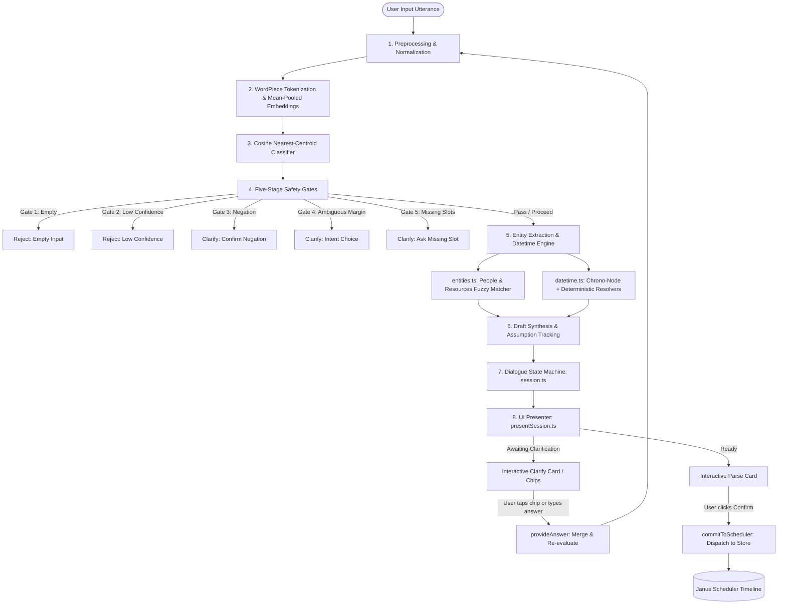

# Janus NLP Engine: Architecture, End-to-End Flow & Developer Guide

## Executive Overview

The `@janus-scheduler/nlp` package is an on-device, zero-backend Natural Language Processing and Multi-Turn Dialogue Engine built specifically for timeline-based calendar scheduling. It processes raw natural language utterances into structured, valid calendar events and execution commands without relying on remote LLMs or network APIs.

This guide provides a comprehensive breakdown of the engine's internal architecture, exact file-by-file responsibilities, data structures, end-to-end message lifecycles, and practical instructions for extending the engine.

---

## 1. High-Level Architectural Flow



---

## 2. File-by-File Code Breakdown

All source code is located in [`packages/nlp/src/`](file:///c:/Users/HP/Desktop/Semester%207/FYP/main-program/packages/nlp/src/). Below is the detailed explanation of each file:

### Core Definitions & Data Types

#### 1. [`types.ts`](file:///c:/Users/HP/Desktop/Semester%207/FYP/main-program/packages/nlp/src/types.ts)

- **What it does:** Defines all TypeScript interfaces and types for the NLP package.
- **Key Types:**
  - `Intent`: Union of supported intents (`"create" | "reschedule" | "delete" | "find" | "availability" | "list_resources" | "show_overview" | "help" | "greeting" | "navigate_time" | "filter_view"`).
  - `ClassificationResult`: Raw ML output containing `{ intent, confidence, margin, route, gate }`.
  - `TimeSpan` & `ResolvedTime`: Detailed structured datetime representation including `startISO`, `endISO`, `localDate`, `localTime`, `durationMinutes`, `timezone`, and structured assumption flags `{ assumed: { date, timeOfDay, duration } }`.
  - `EntityCatalog` & `EntityMatch`: Catalog of bookable rooms, equipment, and people with fuzzy aliases.
  - `EventDraft`: The complete draft event object containing `title`, `time`, `participants`, `resources`, `slotCount`, and `isComplete`.
  - `SessionState` & `SessionQuestion`: Dialogue manager state machine contracts.

#### 2. [`constants.ts`](file:///c:/Users/HP/Desktop/Semester%207/FYP/main-program/packages/nlp/src/constants.ts)

- **What it does:** Contains frozen model weights, classification thresholds, and ML prototype definitions.
- **Key Values:**
  - `CONFIDENCE_THRESHOLD = 0.50`: Minimum cosine similarity score required to accept an intent (Gate 2).
  - `MARGIN_THRESHOLD = 0.08`: Minimum score separation between top-1 and top-2 intents (Gate 4).
  - `TIME_PATTERNS`: Regex collection for deterministic slot verification in Gate 5.

---

### NLP & ML Processing Layer

#### 3. [`preprocess.ts`](file:///c:/Users/HP/Desktop/Semester%207/FYP/main-program/packages/nlp/src/preprocess.ts) & [`normalize.ts`](file:///c:/Users/HP/Desktop/Semester%207/FYP/main-program/packages/nlp/src/normalize.ts)

- **What it does:** Sanitizes, normalizes, and strips punctuation and extraneous whitespace from raw user input.
- **Functions:**
  - `normalize(text)`: Lowercases text, maps unicode characters, and strips non-alphanumeric punctuation while preserving timestamps (`10:30am`, `5-7pm`).

#### 4. [`spelling.ts`](file:///c:/Users/HP/Desktop/Semester%207/FYP/main-program/packages/nlp/src/spelling.ts)

- **What it does:** Deterministic vocabulary spellchecker using SymSpell / Levenshtein distance against the model's domain vocabulary.
- **Functions:**
  - `correctSpelling(text)`: Corrects common typographical errors in calendar keywords (e.g., `"scedule"` $\rightarrow$ `"schedule"`, `"tomorow"` $\rightarrow$ `"tomorrow"`).

#### 5. [`wordpiece.ts`](file:///c:/Users/HP/Desktop/Semester%207/FYP/main-program/packages/nlp/src/wordpiece.ts) & [`embed.ts`](file:///c:/Users/HP/Desktop/Semester%207/FYP/main-program/packages/nlp/src/embed.ts)

- **What it does:** Tokenizes strings into subword tokens (WordPiece) and computes mean-pooled dense embedding vectors.
- **Functions:**
  - `tokenize(text)`: Breaks text into WordPiece IDs using `vocab.json`.
  - `embedUtterance(tokens, vectors)`: Computes normalized 128-dimensional dense semantic vectors using prototype embeddings.

#### 6. [`classify.ts`](file:///c:/Users/HP/Desktop/Semester%207/FYP/main-program/packages/nlp/src/classify.ts)

- **What it does:** Core nearest-centroid classifier.
- **Functions:**
  - `classify(text, artifacts)`: Takes an utterance, computes cosine similarity against all intent prototype vectors, and evaluates the Five Safety Gates.

#### 7. [`gates.ts`](file:///c:/Users/HP/Desktop/Semester%207/FYP/main-program/packages/nlp/src/gates.ts)

- **What it does:** Evaluates the 5 safety gates to ensure routing correctness before acting on an utterance:
  - **Gate 1 (`gate1_empty`):** Rejects empty, whitespace-only, or punctuation-only input.
  - **Gate 2 (`gate2_confidence`):** Rejects utterances with confidence $< 0.50$.
  - **Gate 3 (`gate3_negation`):** Catches negative words (`"don't"`, `"cancel that"`, `"nevermind"`) and requests explicit confirmation.
  - **Gate 4 (`gate4_margin`):** Triggers intent clarification when top-2 intents have margin $< 0.08$.
  - **Gate 5 (`gate5_missing_slot`):** Ensures create/reschedule intents possess a time anchor before proceeding.

---

### Entity Extraction & Datetime Engine

#### 8. [`datetime.ts`](file:///c:/Users/HP/Desktop/Semester%207/FYP/main-program/packages/nlp/src/datetime.ts)

- **What it does:** Deterministic datetime parser and resolver that blends `chrono-node` natural language date extraction with deterministic relative date resolution.
- **Key Architecture:**
  - **Natural Language Dates (`chrono-node`):** Parses arbitrary calendar date expressions (`"August 18"`, `"18th of August"`, `"Sept 25th at 9am"`, `"Oct 12, 2026 at 4:30pm"`).
  - **Relative Expressions:** Deterministically resolves `"today"`, `"tomorrow"`, `"tonight"`, `"next week"`, `"this monday"`, `"in 2 hours"` with calendar arithmetic against the injected clock (`now`).
  - **Time Range & Duration:** Accurately extracts start clock, end clock, and exact durations (e.g. `"from 5pm to 7pm"` $\rightarrow$ 120 minutes, `assumed.duration: false`).
  - **Zero-Assumption Tracking:**
    ```ts
    assumed: {
      date: boolean; // true if date was inferred/invented, false if user gave it
      timeOfDay: boolean; // true if clock was defaulted (e.g. 9:00 AM)
      duration: boolean; // true if duration was defaulted (e.g. 60 mins)
    }
    ```

#### 9. [`entities.ts`](file:///c:/Users/HP/Desktop/Semester%207/FYP/main-program/packages/nlp/src/entities.ts)

- **What it does:** Extracts people, equipment, and room resources from the sentence using an entity catalog with fuzzy sub-phrase matching.
- **Key Capabilities:**
  - **Partial / Multi-word Prefix Matching:** Identifies `"MRI Scanner"` $\rightarrow$ `"MRI Scanner A"`, `"Conference Room"` $\rightarrow$ `"Conference Room A"`.
  - **Title Extraction:** Strips matched entities, dates, times, and prepositions from the utterance to extract the clean event title (e.g. `"schedule team sync tomorrow at 10am"` $\rightarrow$ Title: `"team sync"`). Defaults to `"New Event"` if no title is present.

---

### Multi-Turn Dialogue & State Machine

#### 10. [`session.ts`](file:///c:/Users/HP/Desktop/Semester%207/FYP/main-program/packages/nlp/src/session.ts)

- **What it does:** The multi-turn dialogue manager. Manages user sessions, asks contextual clarification questions, merges follow-up answers, and updates event drafts.
- **Key Functions:**
  - `beginSession(initialText, context)`: Evaluates initial utterance, creates initial draft, checks host completeness requirements, and returns a `SessionState` (`"ready"` or `"awaiting"`).
  - `provideAnswer(currentState, answerText, context)`: Merges the user's answer (e.g., clicking `"2:00 PM"` or typing `"for 45 mins"`) with the prior context, rebuilds the sentence, and advances the dialogue state.
  - `slotIsFilled(slot, draft)`: Determines whether a required slot (e.g., `"when"`, `"resource"`, `"duration"`, `"title"`) has been genuinely satisfied without assumptions.

#### 11. [`presentSession.ts`](file:///c:/Users/HP/Desktop/Semester%207/FYP/main-program/packages/nlp/src/presentSession.ts)

- **What it does:** Transforms raw `SessionState` data into rich UI presentations for chat cards.
- **Card Types Generated:**
  - `ClarifyCardPresentation`: Displays clarification questions with interactive suggestion chips (e.g., time chips, date chips, resource choices). Suppresses unconfirmed/assumed values.
  - `ParseCardPresentation`: Displays confirmed event drafts with structured time badges, resource chips, participant chips, and an active **"Confirm"** button.

#### 12. [`revise.ts`](file:///c:/Users/HP/Desktop/Semester%207/FYP/main-program/packages/nlp/src/revise.ts) & [`smalltalk.ts`](file:///c:/Users/HP/Desktop/Semester%207/FYP/main-program/packages/nlp/src/smalltalk.ts)

- **What they do:**
  - `revise.ts`: Handles revision operations (e.g., `"change room to B"`, `"move it to 4pm"`).
  - `smalltalk.ts`: Provides fast, zero-latency canned responses for greetings, thanks, and help prompts.

#### 13. [`controller.ts`](file:///c:/Users/HP/Desktop/Semester%207/FYP/main-program/packages/nlp/src/controller.ts) & [`index.ts`](file:///c:/Users/HP/Desktop/Semester%207/FYP/main-program/packages/nlp/src/index.ts)

- **What they do:** Public library entry points exposing high-level convenience APIs (`classifyUtterance`, `createNlpController`, `loadArtifactsFromUrl`).

---

## 3. End-to-End Dialogue & Message Lifecycle

Here is a step-by-step trace of how a conversational message flows from the user interface down to the calendar:

### Scenario: _"Need to book MRI Scanner A today"_

```
Turn 1: User says "Need to book MRI Scanner A today"
  │
  ├─► preprocess & spellcheck -> "need to book mri scanner a today"
  ├─► classify() -> Intent: "create" (confidence: 0.94, margin: 0.72)
  ├─► gates() -> All 5 gates PASS
  ├─► datetime.ts -> Date: Today (assumed.date = false), Time: 9:00 AM (assumed.timeOfDay = true)
  ├─► entities.ts -> Resource: "MRI Scanner A", Title: "Need to book"
  ├─► session.ts -> Host requires "when". Date is confirmed, but time-of-day is assumed!
  │                 Status: "awaiting"
  │                 Question: "What time should Need to book MRI Scanner A be?"
  │                 Choices: ["9:00 AM", "10:00 AM", "2:00 PM", "3:00 PM", "4:00 PM"]
  │
  └─► UI (presentSession.ts) -> Renders Clarify Card with Time Chips

Turn 2: User taps chip "2:00 PM" (or types "at 2pm")
  │
  ├─► provideAnswer(state, "2:00 PM")
  ├─► session.ts merges time with existing date -> "Need to book MRI Scanner A today at 2:00 PM"
  ├─► evaluate() re-parses merged sentence:
  │     - Date: Today (assumed.date = false)
  │     - Time: 14:00 (assumed.timeOfDay = false)
  │     - Resource: "MRI Scanner A"
  ├─► session.ts -> All host requirements satisfied!
  │                 Status: "ready"
  │
  └─► UI (presentSession.ts) -> Renders Parse Card with "Confirm" Button

Turn 3: User clicks "Confirm"
  │
  ├─► commitToScheduler(draft, schedulerManager)
  ├─► Generates unique event ID and dispatches ADD_EVENT to store
  └─► Timeline UI instantly re-renders new event block
```

---

## 4. Hands-On Developer Extension Recipes

When you need to make modifications or add new features by hand, refer to the following recipes:

### Recipe 1: Adding a New Resource or Person to Entity Catalog

To make the NLP engine recognize a new room, scanner, or person:

1. Open your application's entity catalog definition (e.g., [`demo/react-demo/src/chat/useNlpEngine.ts`](file:///c:/Users/HP/Desktop/Semester%207/FYP/main-program/demo/react-demo/src/chat/useNlpEngine.ts) or [`demo/angular-demo/src/app/chat/nlp-engine.service.ts`](file:///c:/Users/HP/Desktop/Semester%207/FYP/main-program/demo/angular-demo/src/app/chat/nlp-engine.service.ts)).
2. Add the item to `DEFAULT_ENTITIES`:

```ts
{
  id: "ct-scanner-1",
  name: "CT Scanner 1",
  type: "equipment",
  aliases: ["CT Scanner", "CT 1", "scanner 1", "CAT scan"]
}
```

_The fuzzy matcher in `entities.ts` will automatically recognize partial aliases and exact matches._

---

### Recipe 2: Customizing Completeness Requirements (e.g., Requiring Duration)

By default, Janus creates events with default duration if unstated. If your application strictly requires users to declare duration before confirming:

In your session initialization call:

```ts
import { beginSession } from "@janus-scheduler/nlp";

const session = beginSession(userInput, {
  now: new Date(),
  timezone: "America/New_York",
  entities: catalog,
  // Declare mandatory slots before confirmation is allowed:
  requiredSlots: ["when", "resource", "duration"],
});
```

_When `"duration"` is included, the dialogue manager will automatically prompt: `"How long will [Event] last?"` with duration chips (`30 mins`, `45 mins`, `1 hour`, `2 hours`)._

---

### Recipe 3: Adding or Modifying Suggested Time Chips

To adjust the default suggested hours or chips presented during time clarification:

1. Open [`packages/nlp/src/session.ts`](file:///c:/Users/HP/Desktop/Semester%207/FYP/main-program/packages/nlp/src/session.ts).
2. Edit `TIME_OF_DAY_CHOICES`:

```ts
const TIME_OF_DAY_CHOICES = [
  { label: "8:00 AM", value: "8:00 AM" },
  { label: "9:00 AM", value: "9:00 AM" },
  { label: "10:00 AM", value: "10:00 AM" },
  { label: "1:00 PM", value: "1:00 PM" },
  { label: "2:00 PM", value: "2:00 PM" },
  { label: "4:00 PM", value: "4:00 PM" },
];
```

---

### Recipe 4: Handling Calendar Event Commits in UI Wrappers

When the user taps the **Confirm** button on a parse card, the event is committed to the scheduler.

Reference implementation in [`demo/react-demo/src/chat/commitToScheduler.ts`](file:///c:/Users/HP/Desktop/Semester%207/FYP/main-program/demo/react-demo/src/chat/commitToScheduler.ts):

```ts
export function commitDraftToScheduler(
  draft: EventDraft,
  scheduler: SchedulerManagerService,
): { success: boolean; eventId?: string; error?: string } {
  if (!draft.time) {
    return {
      success: false,
      error: "Cannot commit event without a resolved time.",
    };
  }

  const newEventId = `evt-${Date.now()}`;
  const title = draft.title?.trim() || "New Event";

  const eventPayload = {
    id: newEventId,
    title,
    startDate: new Date(draft.time.startISO),
    endDate: new Date(draft.time.endISO),
    resourceId: draft.resources[0]?.id ?? "default-resource",
    metadata: {
      participants: draft.participants.map((p) => p.name),
      source: "janus-nlp-dialogue",
    },
  };

  scheduler.addEvent(eventPayload);
  return { success: true, eventId: newEventId };
}
```

---

## 5. Testing & Verification

Always run test suites after making code adjustments:

```bash
# Run NLP unit test suite with coverage
npm run test -w @janus-scheduler/nlp

# Run full repository validation (lint, typecheck, build all packages and demos)
npm run validate
```
