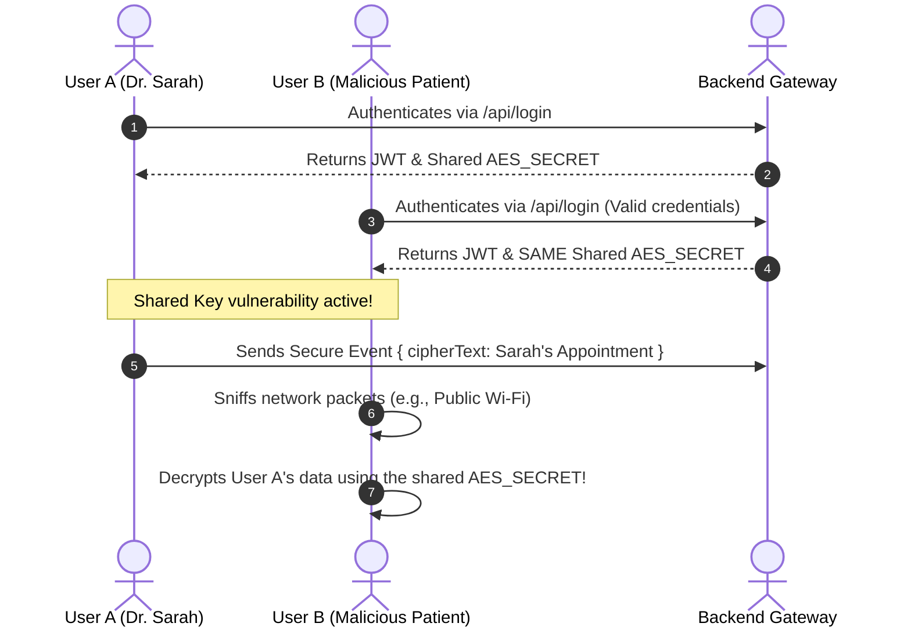
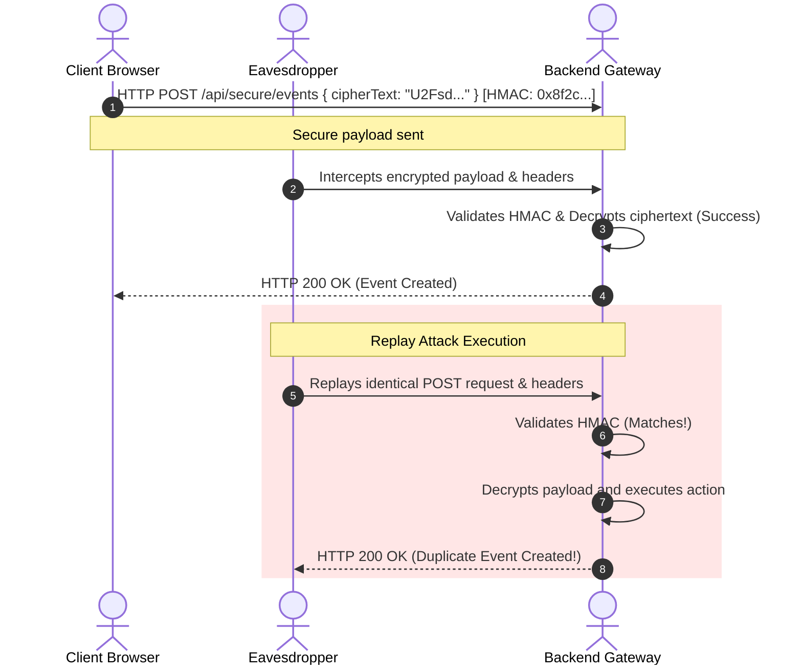

# Janus Scheduler: Secure Communication Update

This document outlines the **Secure Communication Design and Implementation** features recently integrated into the `Janus-scheduler` project. This update was designed to secure data transmission between the frontend scheduler clients and backend API servers, fulfilling advanced security course project requirements.

---

## 🛡️ Security Architecture

The architecture guarantees the **CIA Triad** (Confidentiality, Integrity, Availability) alongside strict **Authentication** by implementing a robust three-layer cryptographic envelope around all API requests.

```
┌─────────────────────────────────────────────────────────────┐
│                 Client Payload Generation                   │
│                                                             │
│   Raw JSON Data ──► [AES-256 Encrypt] ──► Ciphertext (C)    │
│                                                             │
│   Ciphertext (C) ─► [HMAC-SHA256 Sign] ─► HMAC Signature    │
└──────────────────────────────┬──────────────────────────────┘
                               │
                      HTTP Secure Envelope
        (Headers: Authorization: Bearer JWT, X-HMAC-Signature)
                               │
                               ▼
┌─────────────────────────────────────────────────────────────┐
│                 Server Envelope Validation                  │
│                                                             │
│   1. Validate JWT Token ──► Proves Identity                 │
│   2. Validate HMAC Signature ──► Recomputes & Verifies      │
│   3. Decrypt Ciphertext ──► Parsed JSON DB Input            │
└─────────────────────────────────────────────────────────────┘
```

1. **Authentication (JWT)**: Proves _who_ is sending the data.
2. **Confidentiality (AES-256)**: Ensures the data _cannot be read_ in transit.
3. **Integrity (HMAC-SHA256)**: Ensures the data _was not tampered with_.

---

## 📦 Core Package Integration (`@janus-scheduler/core`)

Rather than hardcoding security into a specific framework demo, the cryptographic logic has been built directly into the framework-agnostic core library via the **`SecureApiClient`**.

**Location:** [SecureApiClient.ts](file:///c:/Users/HP/Desktop/Semester%207/FYP/main-program/packages/core/src/security/SecureApiClient.ts)

### How it works:

When a frontend framework uses `SecureApiClient.secureFetch()`, the client automatically:

1. Serializes the raw event data (e.g., patient appointments, private meetings).
2. Encrypts the payload into cipher text using **AES-256** and a shared secret.
3. Computes a cryptographic signature of the cipher text using **HMAC-SHA256**.
4. Injects a JSON Web Token (JWT) into the `Authorization: Bearer` header.
5. Injects the HMAC signature into the `X-HMAC-Signature` header.
6. Transmits the secure envelope to the backend, and automatically decrypts the server's response.

---

## 🖥️ Backend API Gateway (`demo/backend`)

A dedicated Node.js/Express API Gateway was created to serve as the "untrusted" server environment and strictly validate incoming secure requests.

**Location:** [server.js](file:///c:/Users/HP/Desktop/Semester%207/FYP/main-program/demo/backend/server.js)

### Endpoints & Middlewares:

- **`POST /api/login`**: Authenticates users (demo credentials: `admin` / `password`) and issues a JWT alongside the AES shared secret.
- **`/api/secure/events` (POST, PUT, DELETE)**: Protected routes that enforce two strict middlewares:
  - `verifyJWT`: Rejects requests without a valid, unexpired token.
  - `requireSecurePayload`:
    1. Recomputes the HMAC-SHA256 signature of the incoming cipher text.
    2. Compares it to the `X-HMAC-Signature` header. If they don't match, it immediately rejects the request (mitigating Man-in-the-Middle attacks).
    3. Decrypts the AES payload and passes the raw JSON to the database logic.

---

## 🚀 Live Demonstration UI (`demo/react-demo`)

To easily showcase the impact of this security layer during a Viva or presentation, a visual toggle was added to the React Demo application.

**Location:** [App.tsx](file:///c:/Users/HP/Desktop/Semester%207/FYP/main-program/demo/react-demo/src/App.tsx)

### How to Demonstrate:

1. **Start the applications**:
   - Backend: `cd demo/backend && npm run dev`
   - Frontend: `npm run dev:react-demo`
2. **Insecure Baseline (Toggle OFF)**:
   - Drag and drop an event on the calendar.
   - Open your browser's Developer Tools -> Network Tab.
   - **Result**: You will see raw JSON patient/event data exposed in plain text over the network.
3. **Secure Sync (Toggle ON)**:
   - Turn the toggle ON and log in.
   - Drag and drop an event on the calendar.
   - Open the Network Tab.
   - **Result**: You will see the cryptographic headers (`Authorization`, `X-HMAC-Signature`) and the payload will be completely unreadable cipher text (`U2FsdGVkX19...`). The backend terminal logs will prove the server successfully decrypted it.

---

## 🛑 Threat Mitigation Summary

| Threat / Attack Vector                 | Mitigation Strategy                                                                 |
| :------------------------------------- | :---------------------------------------------------------------------------------- |
| **Packet Sniffing / Eavesdropping**    | AES-256 encryption ensures attackers only see unreadable gibberish.                 |
| **Man-in-the-Middle (MITM) Tampering** | HMAC-SHA256 signatures immediately invalidate altered cipher text.                  |
| **Unauthorized Access**                | JWT validation blocks unauthenticated API requests.                                 |
| **Replay Attacks**                     | (Extendable) Short-lived JWT expiry times limit the damage window of stolen tokens. |

---

## ⚠️ Potential Security Breaches & Architectural Vulnerabilities

While the secure communication implementation represents a significant security upgrade over standard plain-text APIs, several **architectural gaps and potential security breaches** remain in the current educational implementation. Below is a detailed cryptographic audit.

### 1. Cryptographic Key Sharing & User Isolation Issues

> [!CAUTION]
> **Severity: CRITICAL**
>
> In the current implementation, every user who successfully authenticates via `/api/login` is handed the **exact same global `AES_SECRET`** (shared symmetric key).



- **The Breach:** Any valid user on the platform receives the global secret key. A malicious tenant or compromise of one user's account allows them to intercept and decrypt the ciphertext of **all** other users in the system. Furthermore, this lacks **Forward Secrecy**: if the global `AES_SECRET` is leaked or stolen from the environment, all past and future network traffic can be fully decrypted.
- **Mitigation:**
  - Do not use a static global key. Implement a key-exchange protocol such as **Diffie-Hellman (ECDH)** during the login phase to dynamically derive a unique ephemeral session symmetric key per user.
  - Alternatively, use **Asymmetric Cryptography** (RSA or Hybrid Encryption) where the client encrypts utilizing the server's public key, and the server decrypts utilizing its private key.

---

### 2. Susceptibility to Replay Attacks

> [!WARNING]
> **Severity: HIGH**
>
> The HMAC signature ensures payload integrity (it cannot be changed in transit), but it does not ensure request **freshness** (there are no timestamps or nonces validated).



- **The Breach:** An eavesdropping attacker on the network can capture a valid secure POST payload `{ cipherText }` along with its headers (`X-HMAC-Signature` and `Authorization`). Even without decrypting or changing the payload, the attacker can replay the identical request multiple times. The backend will verify it successfully every time, resulting in massive database duplication or unauthorized event updates.
- **Mitigation:**
  - Embed a unique `nonce` (cryptographic number used once) and a `timestamp` inside the client's payload.
  - The server must reject requests with a timestamp older than a narrow window (e.g., 5 minutes) and maintain a fast cache (e.g., Redis) of recently used nonces to detect and discard duplicates.

---

### 3. Plaintext Transport Metadata & Credentials Leakage

> [!WARNING]
> **Severity: HIGH**
>
> The local development system runs over insecure HTTP. While payloads are encrypted, transport headers and metadata are completely unencrypted.

- **The Breach:**
  - The initial `/api/login` request transmits the user's `username` and `password` in **plaintext** inside the HTTP body. A packet sniffer (like Wireshark) on a local network can capture the credentials instantly.
  - HTTP headers, including the **`Authorization: Bearer JWT`** token, are exposed in plaintext. An attacker can hijack the JWT to gain authenticated access to all secure endpoints.
  - API endpoint paths (such as `/api/secure/events/:id`) are exposed, leaking transaction frequency and event IDs.
- **Mitigation:**
  - Enforce global **HTTPS/TLS**. Transport Layer Security secures all headers, query parameters, paths, and initial login credentials before any application-level encryption is applied.

---

### 4. String Comparison Timing Attacks on HMAC

> [!IMPORTANT]
> **Severity: MEDIUM**
>
> The backend compares HMAC signatures using a standard JavaScript string inequality check:
> `if (clientHmac !== expectedHmac) { ... }`

- **The Breach:** In JavaScript engines, string comparisons terminate early on the first mismatched byte. An attacker can send forged payloads and carefully measure the response time down to nanoseconds. By observing minor timing variations, they can infer how many characters of their guessed signature matched the server's expected signature, systematically building a valid HMAC signature character-by-character without knowing the secret key.
- **Mitigation:**
  - Perform constant-time string comparison using Node.js's native crypto utilities:
    ```javascript
    import crypto from "crypto";
    const bufferExpected = Buffer.from(expectedHmac, "hex");
    const bufferClient = Buffer.from(clientHmac, "hex");
    if (
      bufferExpected.length !== bufferClient.length ||
      !crypto.timingSafeEqual(bufferExpected, bufferClient)
    ) {
      return res.status(400).json({ error: "Payload tampering detected" });
    }
    ```

---

### 5. Lack of Cryptographic Authenticated Encryption Modes

> [!NOTE]
> **Severity: MEDIUM**
>
> The system implements AES encryption (`CryptoJS.AES.encrypt`) and then computes an HMAC-SHA256 signature separately. This is a manual "Encrypt-then-Sign" construction.

- **The Breach:** Standard AES in `crypto-js` defaults to older, less robust modes if not carefully configured. The manual combination of AES-CBC with HMAC leaves room for implementation errors. If the implementation is slightly altered, it could become vulnerable to padding oracle attacks.
- **Mitigation:** Use modern **Authenticated Encryption with Associated Data (AEAD)** modes, specifically **AES-256-GCM**. GCM natively embeds cryptographic integrity tags within the encryption process itself, eliminating the need for a secondary manual HMAC signature and proving more performant and secure.

---

### 6. NoSQL Injection & Schema Pollution Risks

> [!NOTE]
> **Severity: MEDIUM**
>
> Once the backend successfully decrypted the payload, it directly executes:
> `await Event.create(req.body);` or `await Event.findOneAndUpdate({ id: req.params.id }, req.body);`

- **The Breach:** The backend performs no schema verification on the decrypted JSON payload. A malicious user with valid login credentials can append unexpected fields, injection queries, or trigger Prototype Pollution vulnerabilities that affect the Mongoose/MongoDB model state.
- **Mitigation:** Enforce strict request-body schemas using validation libraries like **Zod** or **Joi** immediately after decryption, stripping out any unauthorized fields before interacting with the database.
