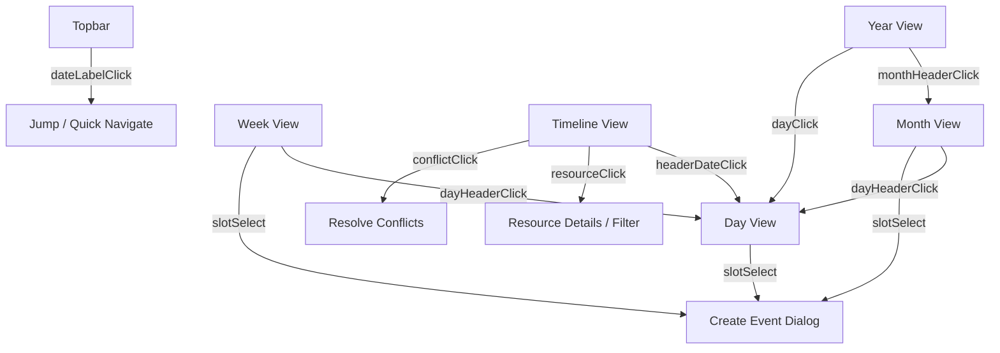

# Calendar Interaction Specification & Developer Guide

## Overview

The **Janus Scheduler Unified Interaction Standard** defines the comprehensive interaction model, event architecture, and cross-framework developer APIs across all calendar views (`janus-year-grid`, `janus-month-grid`, `janus-week-grid`, `janus-day-grid`, `janus-timeline`, and `janus-topbar`).

This specification guarantees seamless drill-down navigation (Year $\rightarrow$ Month $\rightarrow$ Week $\rightarrow$ Day $\rightarrow$ Timeline), full keyboard accessibility, and identical type-safe event contracts across Web Components, React, SolidJS, and Angular.

---

## Prerequisites & Environment

- **Node.js**: `>= 18.x` (LTS recommended)
- **TypeScript**: `>= 5.0`
- **Core Packages**:
  - `@janus-scheduler/core`: `>= 1.0.1`
  - `@janus-scheduler/ui`: `>= 1.0.1`
  - `@janus-scheduler/react`: `>= 1.0.1` (for React apps)
  - `@janus-scheduler/solid`: `>= 1.0.1` (for SolidJS apps)
  - `@janus-scheduler/angular`: `>= 1.0.1` (for Angular apps)

---

## Interaction Architecture & Event Model



### 1. Unified Navigation Links (`navLinks`) Standard

Every grid view accepts the `navLinks` (or `nav-links` in HTML) boolean property (default: `true`). When enabled:

- Month names, day numbers, and date headers render with semantic `<button type="button">` wrappers, subtle hover elevation, focus-visible outlines, and interactive cursors.
- Disabling `navLinks` (`navLinks={false}` or `nav-links="false"`) renders plain non-clickable text, preventing navigation events.

---

## Complete Event Contracts & Types

All detail interfaces are exported from `@janus-scheduler/core` and re-exported by all framework packages:

| Component               | Event Name (DOM)     | Framework Output Prop                     | Detail Type                     | Description                                                |
| :---------------------- | :------------------- | :---------------------------------------- | :------------------------------ | :--------------------------------------------------------- |
| **YearGrid**            | `month-header-click` | `onMonthHeaderClick` / `monthHeaderClick` | `YearMonthHeaderClickDetail`    | User clicked a month heading card in Year view             |
| **YearGrid**            | `day-click`          | `onDayClick` / `dayClick`                 | `YearDayClickDetail`            | User clicked a specific day block in a month mini-grid     |
| **MonthGrid**           | `day-header-click`   | `onDayHeaderClick` / `dayHeaderClick`     | `DayHeaderClickDetail`          | User clicked the day number badge                          |
| **MonthGrid**           | `slot-select`        | `onSlotSelect` / `slotSelect`             | `MonthSlotSelectDetail`         | User clicked empty day cell area to create an event        |
| **MonthGrid**           | `more-click`         | `onMoreClick` / `moreClick`               | `MonthMoreClickDetail`          | User clicked the "+N more" overflow badge                  |
| **TimeGrid** (Day/Week) | `day-header-click`   | `onDayHeaderClick` / `dayHeaderClick`     | `DayHeaderClickDetail`          | User clicked the day title in the column header            |
| **TimeGrid** (Day/Week) | `slot-select`        | `onSlotSelect` / `slotSelect`             | `SlotSelectDetail`              | User clicked a timed slot or All-Day slot                  |
| **Timeline**            | `header-date-click`  | `onHeaderDateClick` / `headerDateClick`   | `TimelineHeaderDateClickDetail` | User clicked a super-header date on the time ruler         |
| **Timeline**            | `resource-click`     | `onResourceClick` / `resourceClick`       | `TimelineResourceClickDetail`   | User clicked a resource card/row header in the left column |
| **Timeline**            | `conflict-click`     | `onConflictClick` / `conflictClick`       | `TimelineConflictClickDetail`   | User clicked a conflict banner or warning badge            |
| **Topbar**              | `date-label-click`   | `onDateLabelClick` / `dateLabelClick`     | `TopbarDateLabelClickDetail`    | User clicked the center date title/label                   |

### TypeScript Type Definitions

```typescript
export interface YearMonthHeaderClickDetail {
  year: number;
  month: number; // 0-indexed: 0 = Jan, 11 = Dec
  monthName: string;
  date: string; // YYYY-MM-DD
  jsEvent?: MouseEvent;
}

export interface YearDayClickDetail {
  date: string; // YYYY-MM-DD
  source: "cell";
  year: number;
  month: number;
  day: number;
  jsEvent?: MouseEvent;
}

export interface DayHeaderClickDetail {
  date: string; // YYYY-MM-DD
  jsEvent?: MouseEvent;
}

export interface MonthSlotSelectDetail {
  date: string; // YYYY-MM-DD
  allDay: boolean;
  jsEvent?: MouseEvent;
}

export interface MonthMoreClickDetail {
  date: string; // YYYY-MM-DD
  hiddenEvents: MonthEvent[];
  jsEvent?: MouseEvent;
}

export interface SlotSelectDetail {
  date: string; // YYYY-MM-DD
  startTime: string; // HH:mm
  endTime: string; // HH:mm
  allDay?: boolean;
  jsEvent?: MouseEvent;
}

export interface TimelineHeaderDateClickDetail {
  date: string; // YYYY-MM-DD
  timestamp: number;
  jsEvent?: MouseEvent;
}

export interface TimelineResourceClickDetail {
  resource: TimelineResource;
  jsEvent?: MouseEvent;
}

export interface TimelineConflictClickDetail {
  conflictingEventIds: string[];
  messages: string[];
  jsEvent?: MouseEvent;
}

export interface TopbarDateLabelClickDetail {
  navLabel: string;
  view?: ViewType;
  jsEvent?: MouseEvent;
}
```

---

## Framework Integration Guides

### 1. React Implementation Guide

```tsx
import React, { useState } from "react";
import {
  YearGrid,
  MonthGrid,
  WeekGrid,
  DayGrid,
  Timeline,
  Topbar,
  type ViewType,
  type YearMonthHeaderClickDetail,
  type DayHeaderClickDetail,
  type TimelineHeaderDateClickDetail,
  type TimelineResourceClickDetail,
} from "@janus-scheduler/react";

export function CalendarApp() {
  const [view, setView] = useState<ViewType>("Month");
  const [activeDate, setActiveDate] = useState<string>("2026-09-02");

  return (
    <div className="calendar-container">
      <Topbar
        view={view}
        onViewSwitch={(detail) => setView(detail.view)}
        onDateLabelClick={(detail) => console.log("Date label clicked", detail)}
      />

      {view === "Year" && (
        <YearGrid
          navLinks={true}
          onMonthHeaderClick={(detail: YearMonthHeaderClickDetail) => {
            setActiveDate(detail.date);
            setView("Month");
          }}
          onDayClick={(detail) => {
            setActiveDate(detail.date);
            setView("Day");
          }}
        />
      )}

      {view === "Month" && (
        <MonthGrid
          navLinks={true}
          onDayHeaderClick={(detail: DayHeaderClickDetail) => {
            setActiveDate(detail.date);
            setView("Day");
          }}
        />
      )}

      {view === "Week" && (
        <WeekGrid
          navLinks={true}
          onDayHeaderClick={(detail: DayHeaderClickDetail) => {
            setActiveDate(detail.date);
            setView("Day");
          }}
        />
      )}

      {view === "Day" && <DayGrid navLinks={true} />}

      {view === "Timeline" && (
        <Timeline
          onHeaderDateClick={(detail: TimelineHeaderDateClickDetail) => {
            setActiveDate(detail.date);
            setView("Day");
          }}
          onResourceClick={(detail: TimelineResourceClickDetail) => {
            console.log("Inspecting resource", detail.resource.name);
          }}
        />
      )}
    </div>
  );
}
```

---

### 2. SolidJS Implementation Guide

```tsx
import { createSignal, Show } from "solid-js";
import {
  YearGrid,
  MonthGrid,
  WeekGrid,
  DayGrid,
  Timeline,
  Topbar,
  type ViewType,
} from "@janus-scheduler/solid";

export function CalendarApp() {
  const [view, setView] = createSignal<ViewType>("Month");
  const [activeDate, setActiveDate] = createSignal<string>("2026-09-02");

  return (
    <div class="calendar-container">
      <Topbar view={view()} onViewSwitch={(detail) => setView(detail.view)} />

      <Show when={view() === "Year"}>
        <YearGrid
          navLinks={true}
          onMonthHeaderClick={(detail) => {
            setActiveDate(detail.date);
            setView("Month");
          }}
          onDayClick={(detail) => {
            setActiveDate(detail.date);
            setView("Day");
          }}
        />
      </Show>

      <Show when={view() === "Month"}>
        <MonthGrid
          navLinks={true}
          onDayHeaderClick={(detail) => {
            setActiveDate(detail.date);
            setView("Day");
          }}
        />
      </Show>

      <Show when={view() === "Week"}>
        <WeekGrid
          navLinks={true}
          onDayHeaderClick={(detail) => {
            setActiveDate(detail.date);
            setView("Day");
          }}
        />
      </Show>

      <Show when={view() === "Timeline"}>
        <Timeline
          onHeaderDateClick={(detail) => {
            setActiveDate(detail.date);
            setView("Day");
          }}
          onResourceClick={(detail) => {
            console.log("Resource clicked", detail.resource);
          }}
        />
      </Show>
    </div>
  );
}
```

---

### 3. Angular Implementation Guide

```typescript
import { Component, signal } from "@angular/core";
import {
  YearGridComponent,
  MonthGridComponent,
  WeekGridComponent,
  DayGridComponent,
  TimelineComponent,
  TopbarComponent,
  type ViewType,
  type YearMonthHeaderClickDetail,
  type DayHeaderClickDetail,
  type TimelineHeaderDateClickDetail,
} from "@janus-scheduler/angular";

@Component({
  selector: "app-calendar",
  standalone: true,
  imports: [
    YearGridComponent,
    MonthGridComponent,
    WeekGridComponent,
    DayGridComponent,
    TimelineComponent,
    TopbarComponent,
  ],
  template: `
    <janus-topbar-ng
      [view]="currentView()"
      (viewSwitch)="handleViewChange($event.view)"
    />

    @if (currentView() === "Year") {
      <janus-year-grid-ng
        [navLinks]="true"
        (monthHeaderClick)="handleMonthHeaderClick($event)"
        (dayClick)="handleDayClick($event.date)"
      />
    }

    @if (currentView() === "Month") {
      <janus-month-grid-ng
        [navLinks]="true"
        (dayHeaderClick)="handleDayClick($event.date)"
      />
    }

    @if (currentView() === "Week") {
      <janus-week-grid-ng
        [navLinks]="true"
        (dayHeaderClick)="handleDayClick($event.date)"
      />
    }

    @if (currentView() === "Timeline") {
      <janus-timeline-ng (headerDateClick)="handleDayClick($event.date)" />
    }
  `,
})
export class CalendarComponent {
  currentView = signal<ViewType>("Month");
  activeDate = signal<string>("2026-09-02");

  handleViewChange(view: ViewType): void {
    this.currentView.set(view);
  }

  handleMonthHeaderClick(detail: YearMonthHeaderClickDetail): void {
    this.activeDate.set(detail.date);
    this.currentView.set("Month");
  }

  handleDayClick(date: string): void {
    this.activeDate.set(date);
    this.currentView.set("Day");
  }
}
```

---

## Accessibility & Keyboard Navigation Standards

1. **Semantic Interactive Elements**:
   - Header labels and day badges are wrapped in `<button type="button">` with `all: unset;` reset and explicit `aria-label` attributes (e.g. `aria-label="View August 2026"`).
2. **Keyboard Activation**:
   - Native `<button>` elements automatically respond to `Enter` and `Space` key presses without manual key listener boilerplate.
3. **Focus Visibility**:
   - Interactive elements feature high-contrast `focus-visible` styling (`outline: 2px solid var(--janus-primary, #6366f1)`) complying with WCAG 2.1 AA standards.
4. **Event Propagation Safety**:
   - Click events stop internal bubbling where appropriate (`e.stopPropagation()`), preventing accidental multi-triggering of parent container handlers.

---

## Troubleshooting & Verification

### Build Verification

To ensure all packages and wrappers compile without type mismatches:

```bash
npm run build --workspaces --if-present
```

### Unit Test Verification

To verify the core engine and event bus test suites:

```bash
npm test
```
