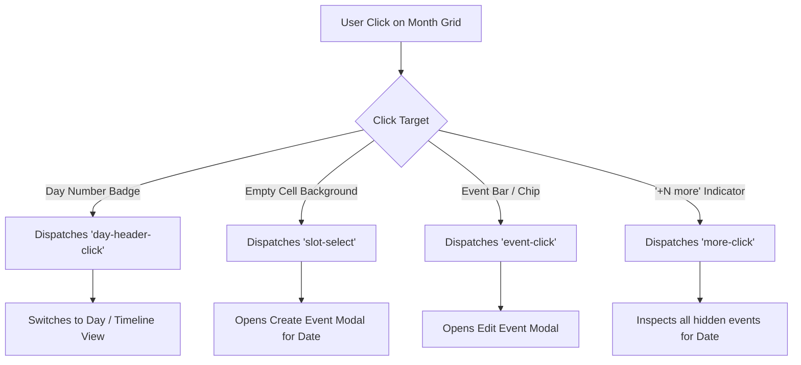

# Janus Scheduler: Month Grid Interaction & Navigation Guide

This document defines the architecture, interaction design, API specifications, and cross-framework integration patterns for the **Month Grid (`janus-month-grid`)** component in the Janus Scheduler NPM ecosystem (`@janus-scheduler/ui`, `@janus-scheduler/react`, `@janus-scheduler/angular`, `@janus-scheduler/solid`, `@janus-scheduler/core`).

---

## 1. Overview & UX Philosophy

In high-density monthly calendars, different user actions represent distinct cognitive intents:

1. **Drill-down Navigation**: The user wants to zoom into a specific day's 24-hour hourly schedule (Day View or Timeline).
2. **Event Scheduling**: The user wants to create a new appointment or event on a given date without leaving the monthly overview.
3. **Event Inspection & Modification**: The user wants to view or edit an existing event card.
4. **Overflow Discovery**: The user wants to view events hidden by cell row limits (`+N more`).

To satisfy these intents without jarring context switches, Janus implements the **Target-Differentiated Interaction Protocol (`navLinks`)**.



---

## 2. Interaction Matrix

| Click Target                                | Emitted CustomEvent                                   | Framework Callback Prop               | Primary User Intent & Recommended Host Action                                   |
| :------------------------------------------ | :---------------------------------------------------- | :------------------------------------ | :------------------------------------------------------------------------------ |
| **Day Number Badge** (e.g. `15` or `Today`) | `day-header-click` & `day-click` (`source: "header"`) | `onDayHeaderClick` / `dayHeaderClick` | **Drill-down Navigation**: Transition to Day or Timeline view for that date.    |
| **Empty Cell Background**                   | `slot-select` & `day-click` (`source: "cell"`)        | `onSlotSelect` / `slotSelect`         | **Quick Creation**: Open the event creation modal pre-populated with that date. |
| **Event Chip / Bar**                        | `event-click`                                         | `onEventClick` / `eventClick`         | **Event Inspection**: Open the event edit/details modal for the selected event. |
| **`+N more` Overflow Button**               | `more-click` & `day-click` (`source: "more"`)         | `onMoreClick` / `moreClick`           | **Overflow Inspection**: Open a day summary popover or drill into the day.      |

---

## 3. TypeScript Contracts & Data Shapes

Exported from `@janus-scheduler/core` and re-exported by all framework packages:

```typescript
/** Detailed payload emitted on any day cell interaction */
export interface DayClickDetail {
  /** Date formatted as "YYYY-MM-DD" */
  date: string;
  /** Exact click target source */
  source?: "header" | "cell" | "more";
  /** All month events occurring on this date */
  events?: MonthEvent[];
  /** Native browser click event */
  jsEvent?: MouseEvent;
}

/** Payload emitted when a day header/number badge is clicked */
export interface DayHeaderClickDetail {
  /** Date formatted as "YYYY-MM-DD" */
  date: string;
  jsEvent?: MouseEvent;
}

/** Payload emitted when empty space in a day cell is clicked */
export interface MonthSlotSelectDetail {
  /** Date formatted as "YYYY-MM-DD" */
  date: string;
  jsEvent?: MouseEvent;
}

/** Payload emitted when the "+N more" overflow indicator is clicked */
export interface MonthMoreClickDetail {
  /** Date formatted as "YYYY-MM-DD" */
  date: string;
  /** All events occurring on this day */
  events: MonthEvent[];
  /** Number of events hidden due to row height constraints */
  hiddenCount: number;
  jsEvent?: MouseEvent;
}
```

---

## 4. Component Properties & Attributes

| Property   | Attribute   | Type                   | Default     | Description                                                                                          |
| :--------- | :---------- | :--------------------- | :---------- | :--------------------------------------------------------------------------------------------------- |
| `navLinks` | `nav-links` | `boolean`              | `true`      | When true, renders day numbers as interactive buttons with hover pills that emit `day-header-click`. |
| `showFab`  | `show-fab`  | `boolean`              | `false`     | When true, renders the floating action button (`+`) in the bottom-right corner.                      |
| `timezone` | `timezone`  | `string`               | `undefined` | Explicit display timezone (falls back to `schedulerStore.timezone` or browser timezone).             |
| `events`   | —           | `MonthEvent[] \| null` | `null`      | Optional externally supplied events overriding the shared Zustand store.                             |

---

## 5. Framework Integration Examples

### 5.1 React (`@janus-scheduler/react`)

```tsx
import React, { useRef, useState } from "react";
import { MonthGrid, DayGrid } from "@janus-scheduler/react";
import type {
  DayHeaderClickDetail,
  MonthSlotSelectDetail,
  ViewType,
} from "@janus-scheduler/react";

export function CalendarApp() {
  const [currentView, setCurrentView] = useState<ViewType>("Month");
  const [selectedDate, setSelectedDate] = useState<string>("2026-09-02");
  const [modalOpen, setModalOpen] = useState(false);

  return (
    <div style={{ height: "100vh", display: "flex", flexDirection: "column" }}>
      {currentView === "Month" && (
        <MonthGrid
          navLinks={true}
          showFab={true}
          onDayHeaderClick={(detail: DayHeaderClickDetail) => {
            // Drill down into Day View
            setSelectedDate(detail.date);
            setCurrentView("Day");
          }}
          onSlotSelect={(detail: MonthSlotSelectDetail) => {
            // Open quick create modal on this date without leaving Month view
            setSelectedDate(detail.date);
            setModalOpen(true);
          }}
          onEventClick={(ev) => {
            console.log("Edit event:", ev.id);
          }}
          onMoreClick={(detail) => {
            console.log(
              `Day ${detail.date} has ${detail.hiddenCount} hidden events`,
            );
          }}
        />
      )}

      {currentView === "Day" && (
        <DayGrid onViewChange={(detail) => setCurrentView(detail.view)} />
      )}
    </div>
  );
}
```

---

### 5.2 Angular (`@janus-scheduler/angular`)

```typescript
import { Component, signal } from "@angular/core";
import { MonthGridComponent, DayGridComponent } from "@janus-scheduler/angular";
import type {
  DayHeaderClickDetail,
  MonthSlotSelectDetail,
  ViewType,
} from "@janus-scheduler/angular";

@Component({
  selector: "app-calendar",
  standalone: true,
  imports: [MonthGridComponent, DayGridComponent],
  template: `
    @if (currentView() === "Month") {
      <janus-month-grid-ng
        [navLinks]="true"
        [showFab]="true"
        (dayHeaderClick)="onDayHeaderClick($event)"
        (slotSelect)="onSlotSelect($event)"
        (eventClick)="onEventClick($event)"
      />
    } @else if (currentView() === "Day") {
      <janus-day-grid-ng (viewChange)="currentView.set($event.view)" />
    }
  `,
})
export class CalendarComponent {
  currentView = signal<ViewType>("Month");

  onDayHeaderClick(detail: DayHeaderClickDetail) {
    this.currentView.set("Day");
  }

  onSlotSelect(detail: MonthSlotSelectDetail) {
    // Trigger creation modal
  }

  onEventClick(event: any) {
    // Trigger event details
  }
}
```

---

### 5.3 SolidJS (`@janus-scheduler/solid`)

```tsx
import { createSignal, Show } from "solid-js";
import { MonthGrid, DayGrid } from "@janus-scheduler/solid";
import type { ViewType } from "@janus-scheduler/solid";

export function SolidCalendar() {
  const [currentView, setCurrentView] = createSignal<ViewType>("Month");

  return (
    <div style={{ height: "100vh" }}>
      <Show when={currentView() === "Month"}>
        <MonthGrid
          navLinks={true}
          showFab={true}
          onDayHeaderClick={(detail) => {
            setCurrentView("Day");
          }}
          onSlotSelect={(detail) => {
            console.log("Create event on date:", detail.date);
          }}
        />
      </Show>

      <Show when={currentView() === "Day"}>
        <DayGrid onViewChange={(detail) => setCurrentView(detail.view)} />
      </Show>
    </div>
  );
}
```

---

### 5.4 Vanilla JavaScript / Web Components (`@janus-scheduler/ui`)

```html
<janus-month-grid id="month-grid" nav-links show-fab></janus-month-grid>

<script type="module">
  import "@janus-scheduler/ui";

  const grid = document.getElementById("month-grid");

  // Drill down when day number is clicked
  grid.addEventListener("day-header-click", (e) => {
    const { date } = e.detail;
    console.log("Navigating to Day View for:", date);
  });

  // Create event when empty cell is clicked
  grid.addEventListener("slot-select", (e) => {
    const { date } = e.detail;
    console.log("Open creation modal for date:", date);
  });

  // Edit event
  grid.addEventListener("event-click", (e) => {
    const event = e.detail;
    console.log("Selected event:", event.title);
  });
</script>
```

---

## 6. Theming & Accessibility

### 6.1 Interactive States

When `navLinks` is active (`true`), the day number button `.mg-day-cell__num-btn` provides:

- **Hover Affordance**: Displays a subtle rounded background pill (`--c-primary-bg`) and shifts the text color to the primary theme color (`--janus-primary-color`).
- **Active State**: Gentle micro-scaling (`scale(0.96)`) for tactile responsiveness.
- **Keyboard Focus**: Full `:focus-visible` accessibility outline conforming to WCAG 2.1 AA focus indicators.

### 6.2 CSS Custom Properties

```css
/* Customize month grid accent and hover tint */
janus-month-grid {
  --janus-primary-color: #6366f1; /* Indigo */
  --janus-primary-bg: #eef2ff; /* Light Indigo Hover */
}
```
